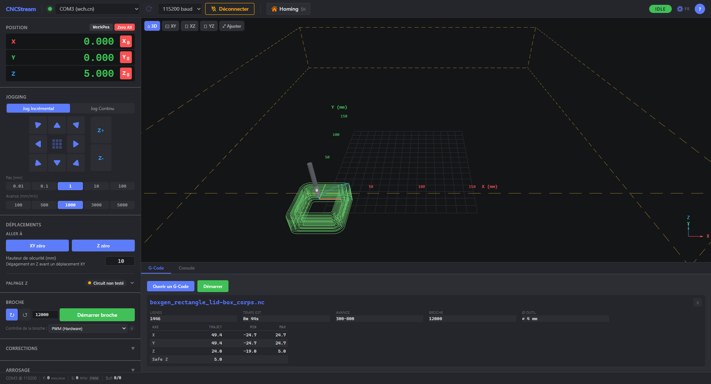
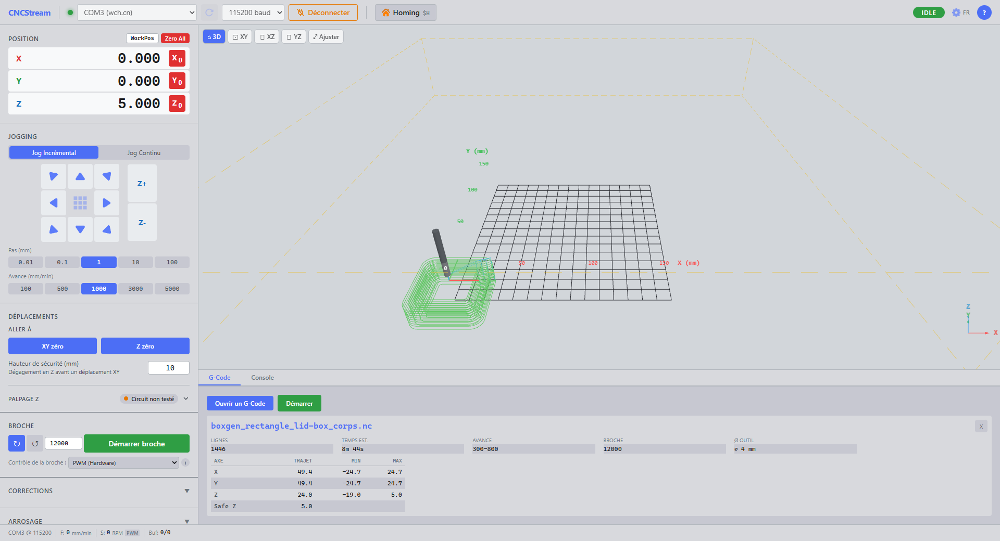

# CNCStream

[Lire en français](README.fr.md)

**CNC machine controller for GRBL 1.1 and grblHAL**

Desktop application built with **Electron**, **React** and **TypeScript**. Modern interface, real-time 3D visualization, full machine control via serial connection.

> **Tested hardware**: used daily on a GRBL 1.1h controller board.

> **grblHAL compatibility**: CNCStream supports the base GRBL 1.1 protocol. In practice, if grblHAL is configured to remain GRBL 1.1 compatible (which is often the default), CNCStream works normally. Features exclusive to grblHAL (extended commands, JSON protocol, etc.) are not supported.

---

## Safety and Tests Before Use

> **CNCStream is machine-tool control software. Improper use can cause serious injury, material damage, or destruction of the workpiece. Read this section carefully before first use.**

### General Precautions

- Never leave the machine unattended during machining
- Keep the emergency stop button (E-Stop) within reach at all times
- Wear appropriate personal protective equipment (safety glasses, hearing protection)
- Make sure the spindle is **completely stopped** before touching the workpiece or tool
- Never disable hardware limit switches

### Checks Before First Connection

- [ ] USB cable is connected to the GRBL controller (not directly to the machine)
- [ ] Limit switches are wired and functional (`$21=1` recommended)
- [ ] Software travel limits are enabled (`$20=1`) with consistent values (`$130`, `$131`, `$132`)
- [ ] Motor current is correctly set on the drivers
- [ ] Spindle is **stopped** and VFD is powered off

### Tests in Order

#### 1. Communication Test

Connect CNCStream → verify GRBL status is received in the connection bar.
Send `$$` in the console → parameters should be displayed.

#### 2. Homing Test (`$H`)

Perform homing **without tool** and **without workpiece**:
- Ensure the machine can reach limit switches without obstruction
- Watch the direction of each axis: must move toward limit switches
- After homing, MPos should display `0.000` on homed axes

> If the machine moves away from limit switches, invert the direction (`$3`) or swap the stepper coil wiring.

#### 3. Jog Test

Test jog in incremental small step (0.1 mm) on each axis **at low speed**:
- Verify X+ moves to the right (or expected direction)
- Verify Z+ moves up (and Z- moves down)
- Test limit switches by approaching slowly: the machine should stop cleanly

#### 4. Probe Z Test

**Prerequisites**: tool in place, probe resting on the workpiece.
- Check the circuit banner in CNCStream: it only appears after the first contact, then follows the probe live — **grey** ("circuit tested, no contact") at rest
- Manually touch the top of the probe with the tool → banner must turn **green** ("Contact detected")
- Run Probe Z while watching the descent: the spindle must descend and stop on contact
- If the machine moves up instead of down, check parameter `$3` (Z invert mask)

#### 5. Dry Run Streaming Test

Before machining a real workpiece, perform a **dry run** (spindle stopped, tool raised to safe height):
- Load a simple G-code file
- Check the dimensions shown in the analysis (min/max per axis)
- Start streaming and monitor the 3D visualizer
- Test Pause / Resume / Stop during execution

#### 6. First Machining

- Start with a soft material (wood, MDF) and conservative cutting parameters
- Stay in front of the machine with your hand on the E-Stop
- Monitor cutting noise and tool temperature

### Recommended GRBL Parameters

| Parameter | Value | Description |
|---|---|---|
| `$20` | `1` | Soft limits enabled |
| `$21` | `1` | Hard limits enabled |
| `$22` | `1` | Homing enabled |
| `$1` | `255` | Motor hold enabled (prevents position loss) |

> These values must be adapted to your machine. Refer to the GRBL documentation for the full meaning of each parameter (`$$` in the console or the Reference tab in CNCStream).

---

## Interface

| Dark mode | Light mode |
|---|---|
|  |  |

---

## Features

### Serial Connection
- Automatic detection of available COM ports
- Baud rate selection (115200 by default)
- Automatic GRBL parameter read (`$$`) on connection
- Connection in the top bar: port, baud rate, Connect / Disconnect, machine state
- Connection errors explained in a dismissible banner under the top bar

### DRO — Digital Read-Out
- Position display on **4 axes**: X, Y, Z, A (A axis can be enabled in settings)
- **MPos / WPos** toggle (machine position / work position)
- Active work coordinate system display (G54 by default) — for single workpiece use, G54 is sufficient
- Direct position entry by clicking a value (`G10 L20` command)
- **mm or inches** display (display conversion only, machine always runs in G21)

### Jogging
- **Incremental** and **continuous** jog (hold key)
- Two independent preset grids by unit (mm / inches)
  - mm steps: 0.01 · 0.1 · 1 · 10 · 100 mm
  - inch steps: 0.001 · 0.01 · 0.05 · 0.1 · 0.5 · 1.0 in
- Keyboard shortcuts: arrows X/Y, Page Up/Down Z, `[` / `]` for step
- A+ / A- buttons for rotary axis (if enabled)

### Top bar: Home / Unlock
- **Home** (`$H`): full homing cycle, shown once connected, greyed out while a job or a move is running
- **Unlock** (`$X`): only shown during an alarm (a red alarm banner under the top bar also offers Unlock then Home)
- **Homing alert**: before a macro that uses machine coordinates (`G53`), a warning appears if no homing was done since the connection

### Moves / Probe Z
- **Go to XY Zero**: raises Z (safe height), moves to X0 Y0, lowers back
- **Go to Z Zero**: lowers Z to 0
- **Safe Height**: configurable clearance height for moves and probe
- Automatic surface detection via touch probe (GRBL `Pn:P` circuit); the Probe Z section is collapsed by default
- **Circuit banner** live under the top bar: green "Contact detected" on contact, grey "Circuit tested: start the probing" without contact (appears after the first contact)
- Probe Z button locked until circuit is validated (per-session safety)
- Descent at 50 mm/min (`G38.2 Z-20 F50`), automatic return to safe height after contact; if nothing is touched within 20 mm, the message "No surface within 20 mm: bring the cutter closer" is shown
- Configurable probe thickness field (0.1 to 50 mm)
- Confirmation dialog with Apply / Cancel option
- Workpiece Z zero applied (`G10 L20 P1`) accounting for probe thickness and safe height

### G-Code Streaming
- Load `.nc`, `.gcode`, `.tap`, `.ngc` files
- File analysis: dimensions (min/max per axis), total path, estimated time, tools, detected safe Z
- Line-by-line streaming with GRBL RX buffer management (128 bytes)
- **Start / Pause / Resume / Stop** (feed hold, cycle start, soft reset)
- **Automatic pause on error**: if the machine answers `error:N` to a job line, the job pauses (axes and spindle stopped) with a red message giving the line and the error
- Start warnings: "Z probe not done" and "Spindle out of service", the latter with a **Start spindle (N rpm)** button to start it from the dialog
- Automatic spindle stop on pause and restart before axes on resume (GRBL realtime command, all modes)
- Progress bar and estimated remaining time

### 3D Visualizer
- Three.js (`@react-three/fiber`) toolpath rendering
- Green: cutting moves (G1) — Blue dashed: rapids (G0)
- Orange: already executed lines — **True-scale cutter** at the current position (diameter read from the G-code when announced, otherwise the setting)
- Dashed orange box: **machine travel**, to check the margin around the workpiece zero (values read from the machine, or entered by hand)
- Views: 3D, XY (top), XZ (front), YZ (side) and **Fit** (frames the loaded file); coloured graduations (red X, green Y) that stay readable when zooming out
- Navigation: rotate (left click, 3D view), zoom (scroll wheel), pan (right click)

### Real-Time Overrides
- **Feed**: 10% to 200%
- **Rapid**: 25%, 50%, 100%
- **Spindle**: 10% to 200% (PWM mode)
- Reset button per override

### Spindle
- M3 (CW), M4 (CCW), M5 (stop) commands
- Three control modes:
  - **PWM**: speed controlled by GRBL, overrides active
  - **Relay**: ON/OFF output, maximum physical speed
  - **Manual**: external physical potentiometer, indicative values
- On pause: automatic spindle and axis stop; on resume: spindle restarts before axes (all modes)
- Mode badge visible in panel, tooltip on each mode

### Coolant
- Flood `M8`, Mist `M7`, Stop `M9`

### Macros
- Predefined macros (200×200 test square, L groove, diagonal width test, X and Y width test, axis test): they are **replaced by the up-to-date version on each application update**, so changes made to them are lost
- Custom macro creation with name, description and multi-line G-code sequence: these are kept
- Execution via streaming mechanism (Pause/Stop functional)
- Automatic local save — macros persist after closing the application (reinstall or new PC: macros lost)

### GRBL Console
- Manual GRBL command entry
- Machine response display (ok, error, alarm, status)
- Session history

### Built-in Reference
- **GRBL error** table (error:1 to error:38)
- **GRBL alarm** table (ALARM:1 to ALARM:11)
- **GRBL parameter** table (`$$`) with description and unit
- Keyboard shortcuts

### Settings
- **Light / dark** theme
- **mm / inches** units
- **A axis** enable
- **Event log** ON/OFF (off by default): records commands, machine answers, state changes with positions (and the position every 5 s while moving) in a daily file, to diagnose a problem afterwards; button to open the folder, files older than 7 days are removed, the console "clear" button also clears the day's log
- **Machine travel** ON/OFF: orange box in the 3D view, X / Y / Z values editable by hand, and a per-axis button for the homing direction (`$23`, off by default)
- **Cutter (mm)**: diameter shown in the 3D view, disabled when the loaded file announces its own
- **Language**: French / English (i18n react-i18next)

---

## Tech Stack

| Layer | Technology |
|---|---|
| Desktop | Electron 41 |
| UI | React 19 + TypeScript |
| Build | Vite / electron-vite |
| 3D | Three.js + @react-three/fiber |
| State | Zustand |
| Serial | serialport 12 |
| i18n | i18next + react-i18next |

---

## Development Commands

### Development mode
```bash
npm run dev
```
Launches Electron + React HMR simultaneously.
`Ctrl+Shift+I` → DevTools — `Ctrl+R` → manual reload.

### Build
```bash
npm run build
```
Generates optimized files in `/out`.

### Production preview
```bash
npm run preview
```
Runs the `/out` version as if installed (requires prior build).

### Windows installer
```bash
npm run package:win
```
Build + electron-builder packaging → creates the `.exe` in `/dist`.

---

## Source Structure

```
src/
├── main/               # Electron main process
│   ├── ipc/            # IPC handlers (commands, probe, serial)
│   └── services/       # SerialPort, CommandQueue, MachineController
├── preload/            # IPC bridge renderer ↔ main
├── renderer/src/
│   ├── components/     # UI panels (DRO, Jog, Zero, Spindle, Macros…)
│   ├── stores/         # Global Zustand state (machine, UI, connection)
│   ├── locales/        # EN / FR translations
│   └── assets/         # SVG icons
└── shared/             # Types and constants shared between main/renderer
```

---

## Author

Developed with the assistance of [Claude](https://claude.ai) AI (Anthropic).

Contact: mm@nano.com
